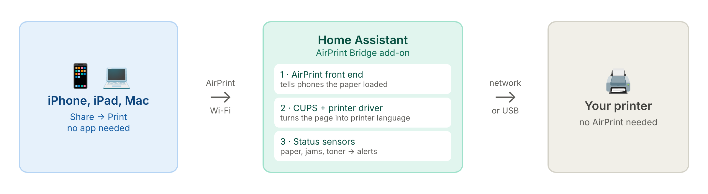
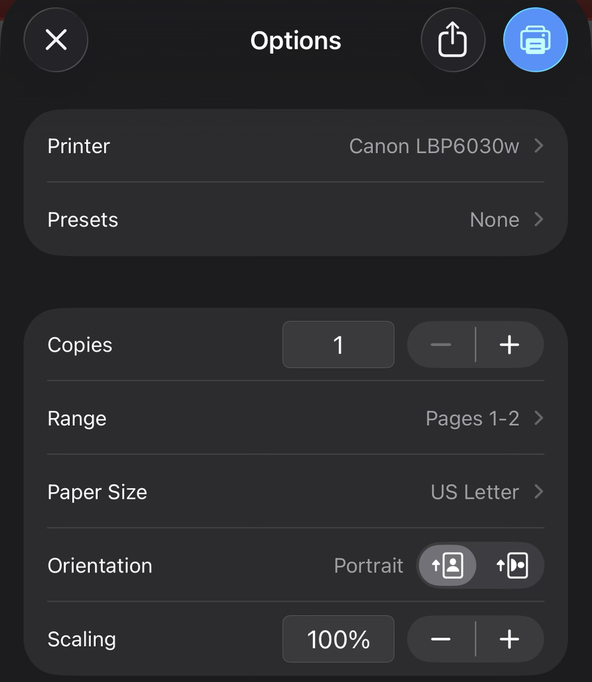
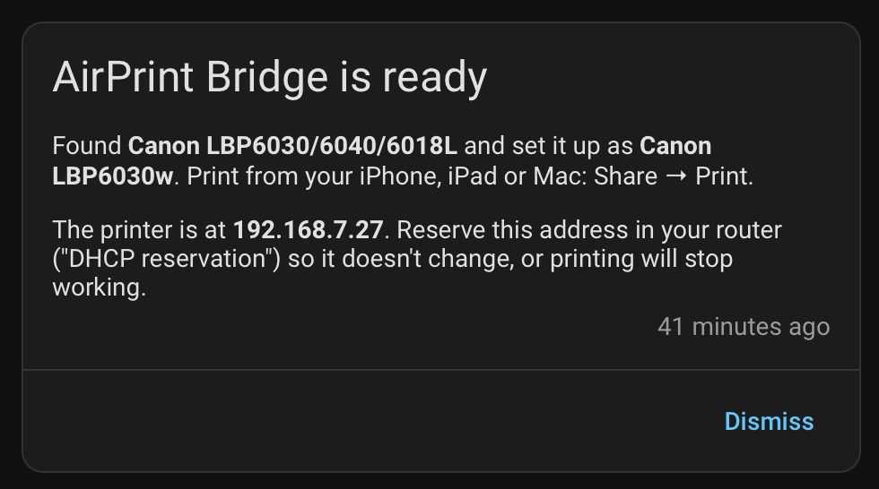
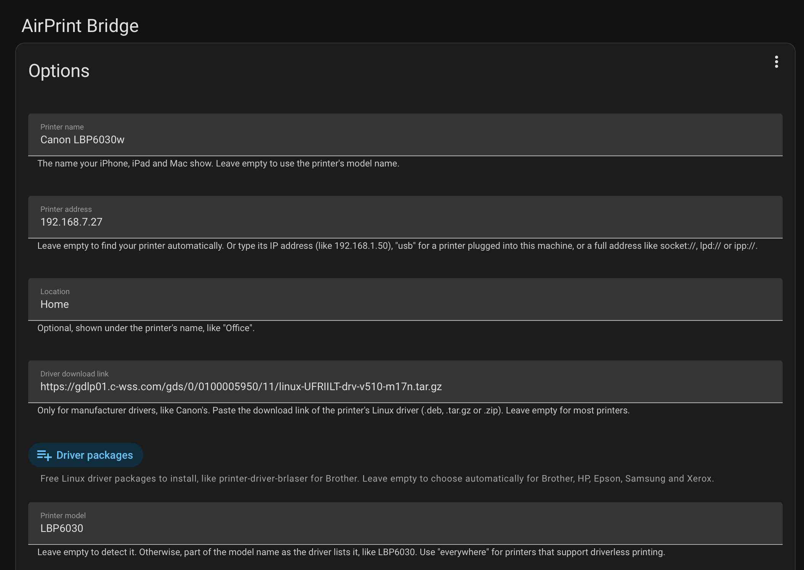
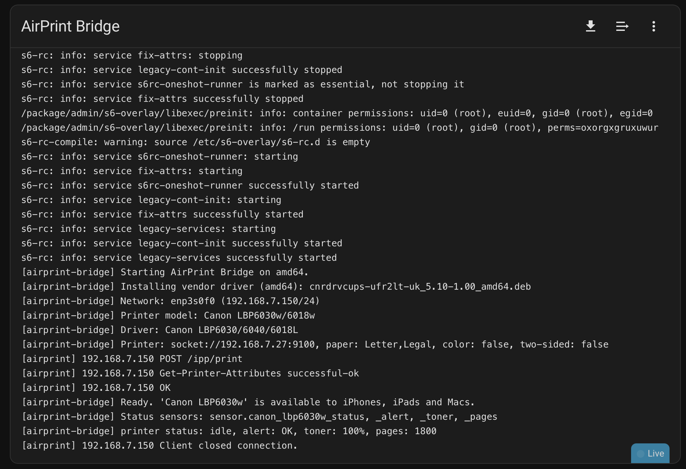

# AirPrint Bridge for Home Assistant

> **Beta.** Tested on two printers so far (see [Tested printers](#tested-printers)).
> If you try it, please [report how it went](https://github.com/learningcodewithAi/airprint-bridge/issues/new?template=printer-report.yml), good or bad.

Print from your iPhone, iPad or Mac to a printer that doesn't support
AirPrint, with no app, no PDF tricks, and no computer left on.

AirPrint Bridge is a Home Assistant add-on. It runs your printer's Linux
driver and presents the printer to your Apple devices as a native AirPrint
printer. Network printers stay on Wi-Fi or Ethernet; USB printers plug into
the Home Assistant machine.

It also gives Home Assistant sensors for the printer: **status**, **alerts**
(no paper, paper jam, door open, toner low), **toner level** and **page
count**, so you can get a phone notification when the printer needs
attention.



### What you'll see on your iPhone

Your printer shows up in the normal Print screen, with the paper that's
actually in the tray (here a Canon LBP6030w, which has no AirPrint of its
own):



And Home Assistant tells you when it has found and set up your printer:



## Before you start

These apply to **network printers** (Wi-Fi or Ethernet). A printer plugged
into the Home Assistant machine by USB doesn't need either.

| | |
|---|---|
| **Required: a fixed IP address** | The bridge and its sensors find the printer by its address. If your router gives the printer a new address, printing and the sensors quietly stop working. Reserve the printer's address in your router (often called a "DHCP reservation" or "reserved IP"); your router's help pages show how. |
| **Recommended: turn off sleep** | A sleeping printer can miss status checks and show as offline, which can trigger false alerts. Turning off sleep (or auto power-off) in the printer's settings keeps the sensors reliable, at the cost of a little more power. Printing itself still works if you leave sleep on. |

## Install

[](https://my.home-assistant.io/redirect/supervisor_add_addon_repository/?repository_url=https%3A%2F%2Fgithub.com%2FlearningcodewithAi%2Fairprint-bridge)

1. Click the button above, or in Home Assistant go to **Settings → Apps →
   App Store** (Add-on Store in older versions), menu (⋮) → **Repositories**,
   and add `https://github.com/learningcodewithAi/airprint-bridge`.
2. Install **AirPrint Bridge**. It's built on your machine, so the first
   install takes a few minutes.
3. **Start it.** It looks for your printer, picks a driver and sets it up.
   A notification (bell icon) tells you when it's ready, or what it needs:
   Canon printers need Canon's driver link, and if you have several
   printers you pick one. The **Documentation** tab explains every setting.
4. On your iPhone: Share → Print → pick your printer. Tap **Continue** if a
   one-time security warning appears.

Requires Home Assistant OS or a Supervised install (apps aren't available on
Container or Core installs). Works on Intel/AMD machines and on ARM
(Raspberry Pi, Home Assistant Green). Phones must be on the same network.

### What setup looks like

The Configuration tab explains every setting in plain English:



And the Log tab ends with "Ready" when the printer is available:



### Example configurations

Most printers need no configuration. These show how to set things by hand.

Canon laser with Canon's Linux driver:

```yaml
printer_name: Office Canon
printer_uri: 192.168.1.50
driver_url: https://gdlp01.c-wss.com/gds/0/0100005950/11/linux-UFRIILT-drv-v510-m17n.tar.gz
driver_match: LBP6030
paper_sizes: Letter,Legal
```

Brother laser with a free Debian driver:

```yaml
printer_name: Brother Laser
printer_uri: 192.168.1.60
driver_packages:
  - printer-driver-brlaser
driver_match: HL-L2350
paper_sizes: A4
```

USB printer plugged into the Home Assistant machine:

```yaml
printer_name: Kitchen Printer
printer_uri: usb
driver_packages:
  - hplip
driver_match: DeskJet 2700
```

## Supported printers

Any printer the bridge can reach (on your network, or by USB) that has a Linux
driver: a manufacturer's Linux driver (Canon, Brother and others), one of
Debian's free drivers (HP, Epson, Brother, Samsung/Xerox, Gutenprint), or
driverless IPP Everywhere.

Printers that already support AirPrint don't need this.

### Tested printers

| Printer | Driver | Connection | Machine | Status | Confirmed by |
|---|---|---|---|---|---|
| Canon imageCLASS LBP6030w | Canon UFRII LT V5.10 (`driver_url`) | Wi-Fi (socket) | Intel Mac mini (amd64) | ✅ Works | @learningcodewithAi |
| Canon imageCLASS MF4890dw | Canon UFRII V6.40 (`driver_url`), duplex on | Wi-Fi (socket) | Virtual machine | ✅ Works | @bbene ([#1](https://github.com/learningcodewithAi/airprint-bridge/issues/1)) |

Tried it with another printer? Please
[fill in a printer report](https://github.com/learningcodewithAi/airprint-bridge/issues/new?template=printer-report.yml),
whether it worked or not, and it'll be added here.

## Notes

- Manufacturer drivers are downloaded by your own add-on from the link you
  provide. They are never included in this repository.
- AirPrint is a trademark of Apple Inc. This project is not affiliated with,
  endorsed by or sponsored by Apple, Canon or any printer manufacturer.

## License

MIT, see [LICENSE](LICENSE). Printer drivers keep their own licenses.
